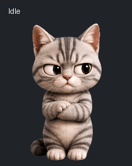
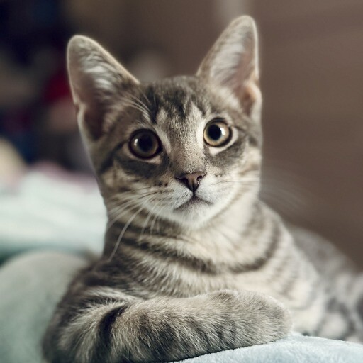
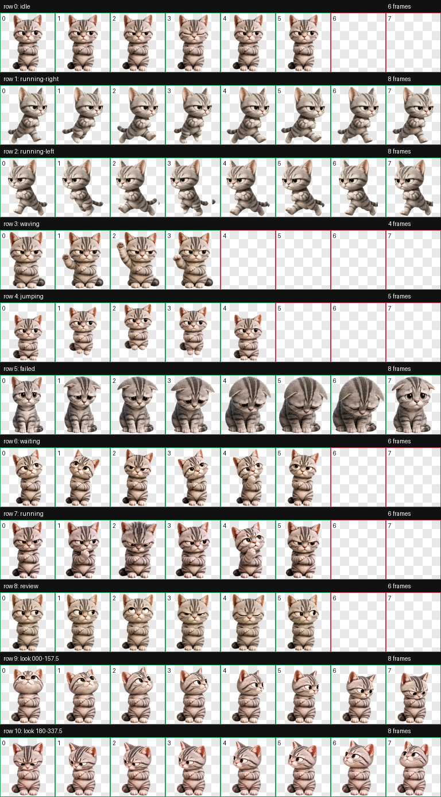
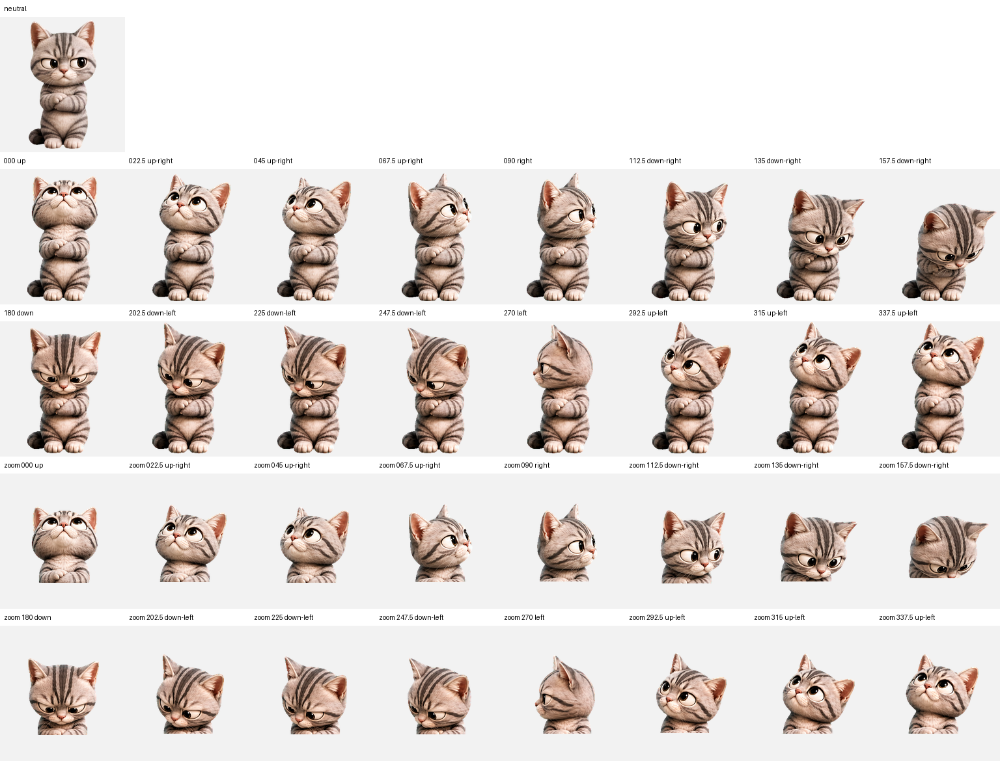
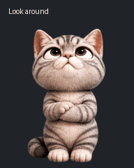
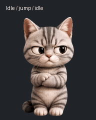
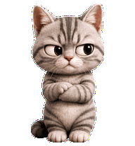
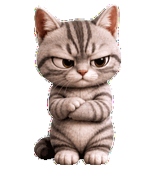
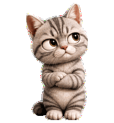
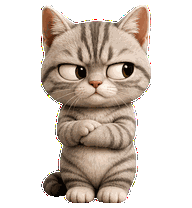

# Larry David Desktop Pet

A tiny animated desktop pet package based on Larry David, my deeply unimpressed silver tabby.



This repo contains the finished spritesheet, animation previews, contact sheets, and a local installer. Larry also tracks the pointer through 16 looking directions.

~~Not _that_ Larry David.~~ The real Larry David here is the cat in my GitHub profile photo, and he is the ~~model~~ reference for this design.



## Preview

<details>
<summary>Animation details and sprite sheets</summary>



Directional looks:



Larry's clockwise look-around sweep keeps his paws planted while his head and eyes follow the pointer:



The hop includes a crouch, visible lift, and a return to his resting baseline:



Individual state previews:

| Idle | Running | Waiting | Review |
| --- | --- | --- | --- |
|  |  |  |  |

</details>

## Contents

- `pet/pet.json` - local pet manifest
- `pet/spritesheet.webp` - final 8x11 spritesheet
- `qa/contact-sheet.png` - contact sheet for all animation states
- `qa/look-directions.png` - neutral pose and all 16 looking directions
- `qa/previews/*.gif` - per-state animation previews
- `qa/motion/` - look-around comparison, jump sequence, and all-state GIF/MP4
- `qa/sources/` - approved artwork strips and refinement briefs
- `qa/validation.json` - structural and visual check results
- `scripts/install-local.sh` - local installer
- `scripts/validate-package.py` - package sanity check

## Install Locally

Requires an existing desktop pet host that supports version 2 `pet.json` manifests and the `selected-avatar-id` setting.

From the repository root, point `LOCAL_PET_APP_HOME` at the host's data folder (the parent of `pets/`):

```bash
export LOCAL_PET_APP_HOME="/absolute/path/to/pet-host-data"
./scripts/install-local.sh
```

This copies `pet.json` and `spritesheet.webp` into `$LOCAL_PET_APP_HOME/pets/larry-david/`, replacing those two files on reinstall. The host's configuration and other pets are left alone.

Select Larry in the host's TOML configuration:

```toml
selected-avatar-id = "custom:larry-david"
```

Wake or restart the host if needed.

## On websites

[The web package](web/README.md) brings Larry's Fortn.ee interactions to other
sites. It includes the existing browser artwork and captions, with no runtime
dependencies. Run `make test-web` to verify the local package or `make pack-web`
to create its tarball. The desktop package and installer stay separate.

## Notes

This is just a tiny polished package for a local desktop companion. The repo includes the finished pet package, preview artifacts, and the source strips for the latest motion refinements.
